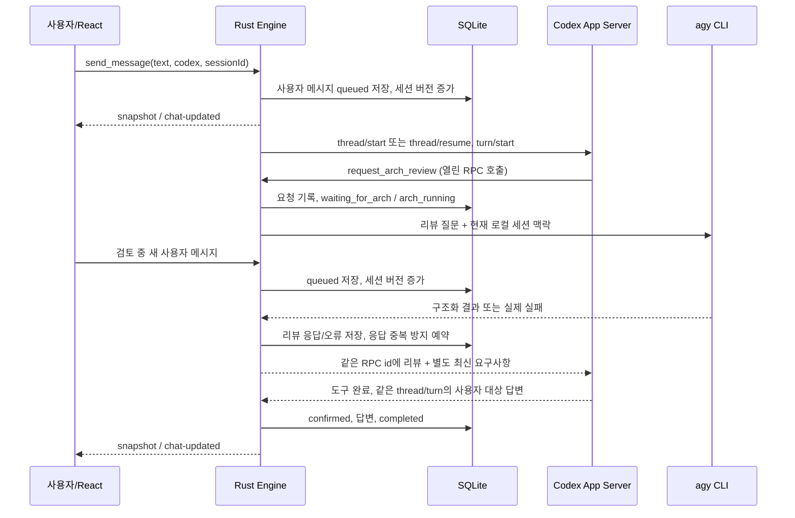

# ESH 현재 아키텍처

확인일: 2026-10-18. 기준은 현재 `mvp-app/` 소스와 `evidence/`의 저장된 결과야. 이 문서는 구현 설명이며, 미구현·검증 공백은 [PROGRESS.md](PROGRESS.md)에 따로 적었어.

## 디렉터리와 경계

| 경로 | 역할 |
|---|---|
| `technical-spike/` | 변경 금지인 초기 CLI 기술 검증 원본, `VERIFIED.json`과 인터페이스 자료 |
| `mvp-app/src/main.tsx` | 3패널 화면, 입력·세션 선택·생성·가져오기, snapshot 구독 |
| `mvp-app/src/MarkdownMessage.tsx` | react-markdown + remark-gfm으로 AI 메시지 표시, 안전한 링크·HTML/이미지 처리 |
| `mvp-app/src/types.ts` | Rust의 camelCase 응답과 맞춘 메시지·세션·상태 타입 |
| `mvp-app/src/panels.ts` | 패널 드래그/키보드 크기 조절, 너비 저장 |
| `mvp-app/src/externalThreads.ts` | 외부 세션 제목 정리, 자동 실행/검증 기록 표시 분류 |
| `mvp-app/src/style.css`, `src/v0.css`, `src/Icons.tsx` | 기존 마크다운·다이얼로그 스타일과 v0 기반 3패널 화면·아이콘 |
| `mvp-app/src-tauri/src/main.rs` | Tauri command, 앱 초기화·종료 hook, debug 검증 command |
| `mvp-app/src-tauri/src/window_state.rs` | 정상 종료 시 창 크기·위치·최대화 상태 저장, 다음 실행 시 복원 |
| `mvp-app/src-tauri/src/engine.rs` | 메시지 직렬 worker, 세션 전환, 리뷰 위임·결과 전달, 수동 압축 job, 종료 |
| `mvp-app/src-tauri/src/stream.rs` | 공개 agentMessage delta 버퍼, 약 40ms 저장·표시, 중단 시 부분 답변 확정 |
| `mvp-app/src-tauri/src/context.rs` | 컨텍스트 사용량·압축 이벤트, 세션별 저장·복구 |
| `mvp-app/src/ContextStatus.tsx` | 전송 버튼 옆 원형 사용률 표시와 상세 팝업의 최근/누적 토큰·압축 상태 |
| `mvp-app/src-tauri/src/models.rs` | 실제 모델 카탈로그 타입과 모델별 추론 강도 검증 |
| `mvp-app/src-tauri/src/cli.rs` | Codex RPC, 프로세스 실행·정리, agy 구조화 결과 검사 |
| `mvp-app/src-tauri/src/store.rs` | SQLite, 채널 migration, snapshot·버전·전달 기록 |
| `mvp-app/src-tauri/src/workspace.rs` | 룸·로컬 세션 migration/CRUD 중 생성·조회, 외부 기록 복사 |
| `mvp-app/src/guiProbe.ts`, `scripts/` | 실제 WebView 검증과 빌드·회귀 검사 |
| `mvp-app/evidence/` | 시점별 CLI audit, WebView 결과, 격리 DB와 성공/실패 기록 |

## 실제 화면과 상태

메인 `v0-shell`은 Tauri 창의 WebView 영역을 여백 없이 채워. 창 자체 제목 표시줄은 Windows가 관리해.

왼쪽은 v0의 ESH Studio 탐색기 형태로 표시해. RECENT의 프로젝트·룸은 폴더 행, 세션은 세로 연결선 옆의 텍스트 행으로 표시해. 최근 세션과 프로젝트·룸은 실제 snapshot의 `sessions`와 `rooms`에서 읽고 검색은 현재 로드된 세션 이름을 거른다. Connections 카드는 Agents 화면 안에 있고 실제 Codex/Antigravity 상태만 표시해. 현재 프로젝트와 룸은 같은 `rooms` 레코드를 가리키며 별도 3단계 도메인이 아니야. 룸에 작업 디렉터리나 Git 저장소를 연결하는 필드도 없어. 룸 제목은 선택과 펼치기·접기를 맡고, 같은 룸을 접거나 펼쳐도 선택 세션은 유지해. 새 프로젝트·세션과 외부 Codex 기록 추가는 기존 Tauri command에 연결돼. v0 목업의 Claude Code/Gemini CLI/OpenCode 연결이나 에이전트 관리 기능은 현재 ESH에 없어 표시하지 않아.

중앙은 v0의 Lead 대화·컴포저 형태로 선택한 로컬 세션의 `main` 사용자/Codex 메시지를 보여. 헤더에는 선택 세션 이름과 모델을 표시해. 리뷰 호출 카드는 실제 snapshot에서 계산하며 클릭하면 해당 읽기 전용 협업 기록으로 이동해. 파일 첨부는 미지원으로 비활성화하고 화면에 명시해. 전송 버튼 옆 원형 컨텍스트 사용률을 누르면 상세 팝업과 수동 압축 버튼이 열려. 모델·추론 강도 선택, 실행 중단, 수동 컨텍스트 압축, 입력 전송은 기존 Tauri command를 유지해. Codex 공개 답변은 item/started와 item/agentMessage/delta를 받아 같은 메시지를 실시간 갱신해. 첫 조각은 즉시, 이후 약 40ms 간격으로 SQLite 저장과 snapshot을 갱신하고 item/completed의 최종 원문으로 확정해. 공개 commentary는 activity 기록으로 분리하며 비공개 추론 이벤트는 표시하지 않아. Arch 리뷰는 구조 검증한 최종 결과만 표시해. 오류는 선택 세션의 배너로 표시해. 사용자 메시지는 원문 텍스트로, Codex·Antigravity 메시지 카드는 MarkdownMessage로 렌더링해. GFM 표·체크리스트·취소선과 제목·목록·인용·코드를 지원해. 체크박스는 비활성 상태이며 오른쪽은 계속 읽기 전용이야. 긴 표·코드 블록은 내부 가로 스크롤을 사용해. HTML은 해석하지 않고, 링크는 http/https만 활성화하며 이미지는 alt 텍스트로 표시해서 외부 이미지를 자동 요청하지 않아. SQLite의 마크다운 원문은 변경하지 않아.

오른쪽은 `collaboration` 채널의 `review_request`, `review_followup`, `review_reply`를 실제 collaborationId별 리뷰 스레드로 묶어 보여. 처음에는 전체 스레드 목록을 표시하고, 선택하면 해당 요청·후속 요청·응답만 상세 화면에 표시해. 뒤로 가기로 목록에 돌아와. 중앙 리뷰 카드로는 최신 스레드 상세에 바로 들어가. 선택·패널 접기/펼치기는 UI 상태야. 리뷰 상태는 저장된 요청·응답·오류를 바탕으로 표시하며, 미응답 기록인데 현재 실행이 없으면 `Unknown`으로 둬. v0 목업의 가짜 승인 상태는 사용하지 않아. 사용자 입력 요소는 없어. Codex 진행 안내(`activity`)와 이전 Arch 직접 대화(`legacy`)는 왼쪽의 접힌 기록으로 분리돼.

React hooks가 상태를 관리하고 `get_snapshot`과 `chat-updated` 이벤트가 DB 기반 전체 snapshot을 전달해. `revision`이 더 오래된 응답은 프런트에서 버려. 선택한 세션과 패널 너비는 localStorage에 저장돼. 에이전트 상태는 현재 앱 전역 2개이며 세션별 상태 이력 테이블은 없어. 실행 중인 세션은 메모리의 `busySessionId`로 구분해. snapshot의 activeRun(id/sessionId/cancelling)은 이번 실행만 식별해서 이전 화면의 중단 버튼이 다음 실행을 잘못 취소하지 않게 해.

메인 창은 정상 종료 시 창의 크기·위치·최대화 여부를 앱 데이터 폴더의 `window-state.json`에 저장하고 다음 실행에서 복원해. `ESH_DATA_DIR`을 지정한 검증 실행은 상태 파일도 해당 격리 폴더에 둬. 첫 실행이나 읽을 수 없는 상태 파일에서는 기본 1600×900 창을 가운데에 표시해. Tauri의 `zoomHotkeysEnabled`로 WebView2 기본 확대·축소 단축키를 사용해. Ctrl+`+`/`-`로 화면 전체 배율을 조절해. 배율은 앱 데이터나 대화 DB에 저장하지 않아.

## 메시지 실행 흐름



`Engine.submit`은 UTF-8 16KB 이하의 입력을 DB에 먼저 저장하고 `mpsc` 큐에 넣어. worker 하나가 모든 로컬 세션을 직렬 처리해. 화면만 전환해도 실행이 취소되진 않아. 다른 세션의 메시지는 해당 세션에 저장된 채 차례를 기다려.

처리할 세션이 바뀌면 기존 RPC를 닫고 저장된 thread를 재개해. 신규·복사 세션의 첫 전송 때만 지속 가능한 `thread/start(ephemeral=false)`와 Dynamic Tool 등록을 수행해. 사용자 입력에는 현재 요청과 최근 60개 로컬 메시지를 JSON 맥락으로 함께 실어. 이는 Codex의 원래 thread 이력과 별개라 재개된 thread에는 중복 맥락이 들어갈 수 있어.

## Blocking Delegation과 최신 요구사항

리뷰 중 Codex 도구 호출은 열린 상태야. Rust가 `agy` 완료를 기다리고 다른 Codex 턴을 시작하지 않아. 같은 턴에서 첫 요청은 `review_request`, 이후 요청은 `review_followup`으로 분류해. 실제 Arch 실행은 턴당 최대 3회야.

도구 응답 payload는 다음처럼 역할을 분리해.

```json
{
  "kind": "arch_review_delivery",
  "archReview": { "status": "success", "reviewId": "...", "conversationVersion": 1, "answer": "..." },
  "latestUserRequirements": { "conversationVersion": 2, "messages": [] },
  "reviewIsStale": true,
  "processingOrder": ["latestUserRequirements", "archReview"]
}
```

`reviewIsStale`은 리뷰 시작 시 세션 버전과 결과 전달 시 세션 버전의 비교야. 검토 중 받은 같은 세션의 `queued` 사용자 메시지를 별도 필드로 보내고 우선 반영하도록 Codex에 지시해. 다른 세션 입력은 포함하지 않아. 전달 후 큐의 해당 입력은 `delivered`로 바뀌고 별도 턴으로 중복 실행되지 않아. 실제 의미 반영 여부를 검증하는 `applied` 상태는 구현되지 않았어.

응답 키는 connectionId/threadId/turnId/callId 조합이야. `tool_deliveries`에 `prepared`를 예약하고 RPC 전송 후 `sent`, 도구 완료 event 후 `confirmed`로 바꿔. 전송 불명확 시 `unknown`이야. 실제 동일 호출 1회 응답은 검증됐지만 프로세스 장애를 넘는 분산 exactly-once 보장은 아니야.

## CLI 연결과 설정

Codex는 `ESH_CODEX_BIN` override 또는 로컬 Codex bin 디렉터리에서 수정 시간이 최신인 exe를 찾아 `--no-daemon app-server --listen stdio://`로 시작해. 설정 override는 MCP 빈 목록, apps 비활성화야. 추론 강도는 turn/start에서 지정해. handshake는 experimental API를 사용해. RPC 요청 대기는 60초, Codex 다음 이벤트 대기는 180초야.

챗 입력창에 Codex 모델·추론 강도 선택이 있어. 실제 App Server의 `model/list`를 모든 페이지 조회해 모델 이름·기본 강도·지원 강도를 받아 표시하고, `set_session_model_settings`로 SQLite에 저장해. 모델을 바꾸면 해당 모델의 기본 강도를 선택해. 지원하지 않는 모델·강도는 Rust가 거부해. 목록 실패는 오류와 재조회 버튼으로 표시하며 Mock 목록을 사용하지 않아.

선택값은 로컬 세션별 `model`, `reasoning_effort` 컬럼에 저장돼. 입력 큐에 넣는 시점에 선택을 복사해 이후 설정 변경이 이미 대기 중인 턴의 설정을 바꾸지 않게 해. 신규 thread/start와 다음 turn/start에 선택 모델을 적용하고, 실제 turn/start 전에 해당 RPC의 최신 카탈로그로 다시 검증해. 같은 thread를 재생성하지 않고 턴별 `model`과 `effort`를 지정해. 실행 중인 Arch 대기의 설정은 변경하지 않고 다음 새 턴부터 적용해.

기존/미설정 세션은 호환 모드야. 신규 thread 기본은 기존과 같은 `gpt-6.1-sol`, 원본 resume 모델은 기존 값을 사용하고 추론 강도는 기존과 같은 `low`야. 명시적으로 모델을 선택하면 실제 지원 강도만 표시해. Arch 모델은 이번 변경에서 유지해. readonly sandbox, approval `never`, 대화 전용 developer instructions가 적용되고 지원하지 않는 서버 도구 요청은 오류 응답해. 작업 파일 수정·명령 실행을 제공하는 개발 도구가 아니야.

Arch는 `ESH_AGY_BIN` 또는 사용자 `.gemini/bin/agy.exe`를 찾아 리뷰마다 새로 실행해. `gemini-3.8-flash-high`, plan 모드, `stream-json`, 현재 reviewId와 conversationVersion을 요구하는 JSON schema를 사용해. 반환된 ID·버전·빈 답변·중복 result·실제 프로세스 종료코드를 검사해. 출력은 최대 4MB야. 시간 제한은 `ESH_ARCH_TIMEOUT_SECONDS`, 기본 120초/허용 30~600초이고 ESH 자동 재시도는 없어.

**Arch 세션 resume은 spike에서 검증됐지만 현재 앱은 `--conversation`을 사용하지 않아.** 반환된 conversationId는 응답/audit에 남고 다음 리뷰를 이어가는 영속 세션 키로 사용되진 않아. plan 모드와 도구 금지 프롬프트를 OS 수준의 Arch 도구 차단 보장으로 설명하지 마.

## 외부 Codex 세션 가져오기

목록 조회/가져오기는 worker와 별도의 단기 App Server 프로세스를 사용해. `thread/list`는 30개 단위 커서, 제목 검색, 지정 sourceKinds와 로컬 state DB 조회를 사용해. 목록 분류는 프런트의 현재 로드된 페이지에서 적용돼. `exec`, 에이전트 메타데이터·경로, 알려진 검증 세션/테스트 경로는 체크해서 볼 수 있어. debug GUI 검증에서 새로 만든 thread는 `threadSource=esh-verification`으로 표시해서 다음 목록에서 기본 숨김 처리해. 외부 도구가 만든 임의의 모든 테스트를 식별하는 분류기는 아니야.

| 방식 | 현재 동작 |
|---|---|
| `copy` (기본) | 공개 user/agent 텍스트를 로컬에 복사. 첫 메시지 때 새 Codex thread와 Arch 도구 생성. 원본 보존 |
| `resume` | 원본 threadId로 재개해 실제 원본에 새 발언 추가. 기존에 없던 Arch Dynamic Tool은 새로 등록하지 않음 |
| `legacy` | migration으로 복구한 과거 세션. 열린 호출 복원 없이 다음 입력에서 새 지속 thread 생성 |

이력은 `thread/read`, `thread/turns/list`로 읽고 필요하면 includeTurns fallback을 사용해. 첨부·추론·도구 원시 출력은 복사하지 않아. 로컬에서 이미 연결된 ESH thread는 앱의 공개 기록을 우선 사용해 내부 JSON 포장 노출을 줄여. 가져온 대화는 시점별 스냅샷이며 외부 앱과 실시간 동기화하지 않아. active 원본 추가는 차단하지만 전역 동시 실행 잠금은 없어.

## SQLite와 식별자

위치는 `ESH_DATA_DIR/chat.sqlite`, override가 없으면 Tauri `app_local_data_dir()/chat.sqlite`야. SQLite WAL, foreign_keys 활성화, busy timeout 5초를 사용해.

| 테이블 | 저장 내용 |
|---|---|
| `rooms` | 이름과 생성 시간. 프로젝트·룸 역할을 함께 담당 |
| `chat_sessions` | 로컬 UUID, room_id, 이름, thread_id, codex_session_id, source_thread_id, mode, 세션 version, model, reasoning_effort |
| `messages` | 전역 증가 sequence, UUID, 발화자, 내용, 생성 시각, delivery, version, error, channel/kind, 룸·로컬 세션·thread·turn·call 연결 |
| `agents` | Codex/Antigravity 현재 상태와 상세·갱신 시각 |
| `tool_deliveries` | 호출별 RPC id와 응답 전달 상태 |
| `audit` | Codex/Arch 프로토콜·stderr·프로세스·종료 로그 |
| `meta` | 앱 전역 메시지 버전과 화면 revision |
| `session_context` | 로컬 세션별 thread, 마지막·누적 토큰, 보고 시각, 압축 item ID/상태/횟수/완료 시각 |

로컬 `Session.id`와 Codex `threadId`/`sessionId`를 구분해. 사용자 입력은 해당 chat_sessions.version과 전역 meta.version을 올려. 리뷰 최신성 판단은 세션 버전을 사용해.

schema 0→1은 채널/식별자를 추가하고 audit으로 과거 리뷰를 복원해. 1→2는 룸·로컬 세션·메시지 chat_session_id를 추가해. 구버전 항목은 식별자·본문·순서·시간을 보존하는 검증이 있어. 2→3은 세션별 nullable model/reasoning_effort 컬럼을 추가해 기존 메시지와 선택을 보존해. 초기 룸은 `default`, 초기 세션은 `default-session`이야.

## 상태와 종료

주요 상태는 `idle`, `running`, `waiting_for_arch`, `arch_running`, `resuming`, `cancelling`, `completed`, `failed`, `cancelled`, `unknown`이야. 별도 job 테이블은 없어.

입력창의 중단 버튼은 선택한 세션에서 실행 중인 activeRun에만 보여. `cancel_run(sessionId, runId)`가 실제 실행 ID를 검사하고 같은 세션의 당시 queued 입력을 cancelled로 바꾼 뒤 실행별 stop watch를 보내. 중단 중 같은 세션의 새 입력은 거절하고 다른 세션의 큐는 유지해. 취소된 queued 입력은 다음 모델 공유 맥락에서 제외하지만 화면과 DB에는 남겨.

Arch 중에는 CLI reader가 신호를 받아 프로세스 트리 종료를 확인한 뒤 돌아와. 열린 Codex 검토 호출에 cancelled/success=false를 한 번 반환하고 turn/interrupt를 요청해. Codex는 turn/completed의 interrupted 상태를 확인해야 cancelled가 돼. 이미 완료된 턴은 completed, 실제 실패는 failed를 유지하고 확인 시간 초과는 unknown으로 기록해. 실제 시작 이벤트 전에 interrupt가 거부된 경우 해당 turn/started를 확인하고 interrupt를 다시 요청해. 이것은 Arch 리뷰 재시도가 아니야. 정상 중단은 Codex 연결/thread를 유지해 다음 사용자 요청을 처리해. 중단 결과 확인이 불가능한 연결만 정리해.

Codex 시작 요청을 이미 보낸 경우 실제 turnId를 확인하기 위해 start 응답을 기다려. 이 구간은 기존 RPC 제한(60초)까지 중단 완료가 지연될 수 있어. turnId 확인 후 interrupt/종료 event 대기는 최대 12초야. 초기화/모델 목록 준비 단계는 실행별 중단 신호를 확인해. 중단 중 앱 종료도 별도 전역 신호로 처리해.

창 닫기는 기본 종료를 막고 Engine.shutdown을 기다려. 접수 차단 → stop watch 신호 → Arch 종료/강제 정리 → 열린 Codex 호출에 취소 실패 반환 → Codex interrupt/종료 → 상태 기록·WAL checkpoint 순서로 구현돼. shutdown 전체 대기는 최대 25초야. 프로세스 종료 확인 실패는 unknown으로 기록하는 경로가 있어.

재시작하면 진행 중이던 agent/tool 상태를 unknown, 대기 사용자 입력을 interrupted로 바꿔. 메모리 실행 큐와 열린 RPC는 복원하지 않아. 기존 메시지·세션·threadId 복구와 열린 도구 호출 자동 재개는 다른 기능이야.

실행 파일은 현재 `esh-chat-mvp4.exe`, 앱 identifier는 `local.esh.conversation`, Tauri/Cargo 패키지 버전은 `0.1.0`이야. bundle은 비활성화되어 있고 설치 프로그램·자동 업데이트는 없어.

Windows에서는 debug/release 모두 GUI 서브시스템으로 빌드해서 ESH 자체 콘솔 창을 만들지 않아. Codex·Arch·taskkill 자식 프로세스의 CREATE_NO_WINDOW 설정과 stdio 파이프는 유지해.

최신 실행 파일 관리 결정: `esh-chat-mvp4.exe` 하나를 같은 이름으로 갱신해. 수정본마다 실행 파일 이름의 번호를 올리던 이전 규칙은 더 이상 적용하지 않아.

모델 선택 프로토콜 참고: [공식 App Server 문서](https://learn.chatgpt.com/docs/app-server)의 model/list 및 turn/start. 목록은 계정·설치 버전의 실제 반환값을 기준으로 사용해.

GUI 검증 로그의 메시지 content는 DB의 원문이며 renderedText는 실제 표시 텍스트야. 마크다운의 구조 변환은 별도 WebView fixture 검사로 확인해. synthetic rendering fixture를 실제 CLI 응답 검증으로 집계하지 않아.

중단 프로토콜 참고: [App Server turn/interrupt](https://learn.chatgpt.com/docs/app-server#interrupt-a-turn). 실제 설치본에서 요청 ACK와 턴 시작 사이 경합이 관찰되어 turn/started 이후 중단 요청을 보완했어.

## Codex 실시간 출력

`stream.rs`가 item ID별 버퍼와 메시지 ID를 관리해. `streaming` 메시지를 새 행으로 계속 추가하지 않고 같은 행을 갱신하며 최종 전달 상태는 `delivered`야. 중단·오류·정상 종료에서는 남은 버퍼를 저장하고 미완성 답변을 `interrupted`로 확정해. 재시작 시 남아 있는 `streaming` 행도 interrupted로 바꾸며 열린 호출은 재개하지 않아. 비정상 종료에서는 마지막 저장 이후 40ms 이내의 메모리 조각은 유실될 수 있어. React는 같은 메시지의 내용 변경에 맞춰 마크다운과 스크롤을 갱신하고 작성 중/중단된 답변을 표시해. 스키마 변경은 없어.

## 컨텍스트 사용량과 압축 상태

schema 3→4는 `session_context` 테이블을 추가하고 기존 세션·메시지는 그대로 보존해. snapshot.contexts에서 선택한 로컬 sessionId와 threadId가 모두 맞는 행만 표시해. 새 세션·가져온 사본은 이벤트 수신 전까지 사용량 대기/압축 관측 전이야. 다른 앱에서 과거 발생한 압축을 복원하거나 관측 전 상태를 압축 미실행으로 단정하지 않아.

`Rpc.next`가 `thread/tokenUsage/updated`의 last/total/modelContextWindow를 저장하고 Engine 이벤트가 React snapshot을 갱신해. RPC 요청 중 보류된 이벤트는 실제 소비할 때 한 번 처리해. 사용률은 last.totalTokens / modelContextWindow의 추정치이며 total 누적값을 분자로 사용하지 않아. 분모가 미제공·0이면 비율을 표시하지 않아. 입력창·대기 입력과 계정 한도를 포함하는 지표가 아니야. 최근/누적/입출력/캐시 토큰과 보고 시각을 펼쳐볼 수 있어. 숫자는 서버 보고 그대로 보존하므로 압축 직후 totalTokens와 상세 카운터 합이 다를 수도 있어.

`contextCompaction` item/started→압축 중, item/completed→완료·횟수·시각을 기록해. item ID로 보류 이벤트 중복 처리 시 횟수 중복을 막아. 압축 시작·완료 또는 모델 설정 변경 뒤에는 이전 비율을 숨기고 새 사용량 갱신을 기다려. 실행 실패/취소 시 진행 중 압축만 failed/cancelled로 정리하고, 종료 확인 불가·재시작에서는 unknown으로 기록해. 압축 완료는 실제 완료 이벤트에만 근거해. 사용자 메시지 원문이나 Arch 채널을 변경하지 않아.

자동 압축은 Codex가 수행해. ESH는 임계값을 추측하거나 설정 UI를 제공하지 않아. 대신 사용자가 직접 요청하는 수동 압축 버튼을 제공해. `compact_session(sessionId)`가 worker 큐에 압축 job을 넣고, worker가 해당 세션의 Codex 연결을 확보한 뒤 `thread/compact/start`를 호출해. 설치본 0.163.0-alpha.10.2에서 이 요청은 `{}`를 반환하고 새 턴을 열어 `contextCompaction` item을 started→completed로 보내는 것을 확인했어. ESH는 같은 item ID의 completed를 확인해야만 완료로 기록하고, 이어서 그 턴의 `turn/completed`를 최대 30초 기다려 다음 턴이 열린 턴과 겹치지 않게 해. 완료를 확인하지 못하면 `unknown`, 요청·실행 오류는 `failed`로 남기고 자동 재시도하지 않아. 실행 중(activeRun 존재)이거나 전달 대기 메시지가 있거나 threadId가 없으면 요청을 거절해. 압축은 Codex 쪽 스레드 컨텍스트만 요약하며 ESH의 `messages`·`audit` 기록은 변경하지 않아.

debug `ESH_GUI_PROBE=context`에서만 검증용 Codex 자식 프로세스에 model_auto_compact_token_limit=3000을 전달해 실제 자동 압축을 낮은 토큰으로 관측해. 일반 실행의 임계값과 기존 사용자 설정·인증 파일은 바꾸지 않아.

프로토콜 근거: [공식 App Server 문서](https://learn.chatgpt.com/docs/app-server)의 thread/tokenUsage/updated와 contextCompaction lifecycle. 설치본 0.163.0-alpha.10.2에서 생성한 스키마는 `mvp-app/evidence/context-protocol-20261018/`에 보존해. 자동 압축 임계값은 해당 사용량 이벤트에 제공되지 않아 진행률로 꾸미지 않아.
